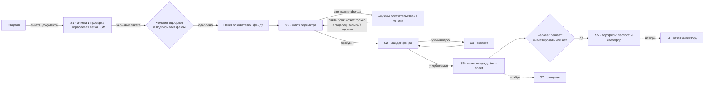

# Nocvela для технического человека

Версия 1 · 29.10.2026 · для Сергея Белолипецкого · подготовлено по документам проекта и коду ветки master (коммит 54295a1).
Чего нет в источниках, помечено «НЕ ПОДТВЕРЖДЕНО» или «не найдено».

## В курсе за 30 секунд
- Nocvela — закрытая система проверяемых данных для сделок в Life Science (биотех, медтех): каждое утверждение стартапа хранится вместе с источником и уровнем доказательства.
- Четыре стороны: стартап, инвестор, покупатель, Life Science Manager (LSM). Работа разложена на 7 кабинетов S1–S7.
- К пилоту 05.11 готовы S1–S3 (в master), частично S5 и S6; кода S4 и S7 нет. По решению РБ-114 05.11 показываем только готовые части.
- Главное правило: машина собирает и проверяет, решает человек. Неподтверждённое не становится фактом.

## 1. Что это простыми словами
Стартап в биотехе приходит к инвестору с презентацией. Инвестор не может быстро проверить, где правда, а где надежда: риски спрятаны в регуляторике, клинике, патентах. Обычно каждая сторона проверяет всё сама и с нуля.

Nocvela хранит одну общую историю проекта. Система раскладывает каждое утверждение по уровню доказательства: «просто заявление», «документ компании», «документ третьей стороны», «госреестр». Система находит пробелы и противоречия. Человек (аналитик, владелец фонда) подтверждает существенное и принимает решения.

Система закрытая: нет публичной регистрации. Войти можно только по списку разрешённых адресов. Пилот проходит в посевном фонде Artgen Seed Fund. До решения юриста на стенде только учебные (синтетические) данные.

## 2. Четыре стороны
| Сторона | Кто это | Что получает | Где в системе |
|---|---|---|---|
| Стартап | основатели проекта | понимает, чего не хватает до инвестиций, и получает пакет для инвестора | S1 (до раунда), S4 (после инвестиций: кода нет) |
| Инвестор | фонд, его аналитик, ведущий инвестор, синдикат | видит, подходит ли проект под правила фонда, какие риски, как живёт портфель | S2, S3 (как заказчик экспертизы), S5, S6, S7 (синдикат: кода нет) |
| Покупатель | фарма-компания, стратег, лицензиат | рано видит актив, получает его уже проверенным | отдельного кабинета нет ни в коде, ни в списке S1–S7; сторона в замысле, после 05.11 |
| Life Science Manager (LSM) | отраслевой менеджер развития проекта (человек + цифровой помощник) | ведёт проект через регуляторику, клинику, качество, производство, патенты | на 05.11 живёт внутри S1 как отраслевая ветка проверки (барьеры К1–К7); отдельного кабинета нет (очередь Q-113, после 05.11) |

## 3. Кабинеты S1–S7: кто что делает и что готово
| Кабинет | Для кого | Кто что делает | Бизнес-процесс | Состояние кода (master) | 05.11 |
|---|---|---|---|---|---|
| S1 · Стартап до раунда | основатель, аналитик фонда | Основатель заполняет анкету (форма Tilda → приложение). Система раскладывает утверждения по уровням доказательств, прогоняет 18 проверок качества (шлюзы A1–A18) и отраслевую ветку LSM. Основатель бесплатно получает балл, 3 главных пробела и риск по каждому. Аналитик подписывает факты. Пакет уходит основателю только после одобрения человеком | БП-01 | есть (модуль s1_intake, маршруты /s1/*) | показываем |
| S2 · Инвестор: мандат и первичный разбор | фонд, аналитик | Фонд проверяет, подходит ли проект под правила фонда (мандат). Итог: «углубляемся / наблюдаем / отказ» и список пробелов. Проверка не запускается без пройденного шлюза S6 | БП-02 | есть (s2_mandate, /s2/*) | показываем |
| S3 · Эксперт: один вопрос | заказчик экспертизы, эксперт | Заказчик задаёт эксперту один конкретный вопрос. Эксперт отвечает, пишет «ПРОБЕЛ» или «ОТКАЗ» и видит только своё задание. Платит фонд | БП-07 | есть (s3_expert, /s3/*) | показываем |
| S4 · Стартап после инвестиций | основатель | Основатель получает черновик отчёта инвестору и реестр обещаний с порогами тревоги | БП-03 | кода нет (0 файлов, 0 PR) | нет, ноябрь |
| S5 · Портфель | инвестор | Фонд видит паспорт каждой компании портфеля и светофор: «в норме / внимание / риск» (например, запас денег меньше 9 или 6 месяцев). При расхождении данных система задаёт вопрос; новый раунд запускает проверку | БП-04 | частично, ≈40–60% (portfolio, /portfolio; доделка — issue #16) | показываем готовую часть |
| S6 · Вход в сделку | инвестор | Шлюз периметра: проект вне правил фонда получает статус «нужны доказательства» или «стоп» и дальше не идёт. Снять блок может только владелец, и это записывается в журнал. Вторая часть — пакет подготовки к сделке до term sheet: условия и пробелы | БП-05 | частично, ≈50% (s6_perimeter, /s6/*; пакет входа — issue #17) | показываем готовую часть |
| S7 · Синдикат | синдикатор | Ведущий инвестор собирает соинвесторов: бриф, стороны, риски. Деньги инвесторов через систему не идут | БП-06 | кода нет (0 файлов, 0 PR) | нет, ноябрь |

Даты S4 и S7 в ноябре и исполнитель не назначены (НЕ ПОДТВЕРЖДЕНО). Что перенесён именно S4, прямой строкой не записано: это вывод из «готовность 5 из 7» и «остальное — в ноябре».

Что увидит участник пилота 05.11: вход по приглашению; анкету стартапа (S1) с кнопкой «Сообщить о проблеме»; проверку мандата (S2); задание эксперту (S3); портфель с паспортами (S5); остановку проекта вне правил фонда (S6). Цен и договоров в пилоте нет.

## 4. Как идут данные

Пунктир — частей нет в коде. Порядок «шлюз S6 перед S2» взят из кода: S2 без пройденного шлюза S6 отвечает отказом. В бизнес-процессах вход в сделку (БП-05) идёт после первичного разбора (БП-02); в коде у S6 две части — шлюз периметра и пакет входа.

## 5. Принципы, которые должен держать стенд
1. **Машина делает, человек решает.** Система извлекает, сверяет и предлагает. Решение «инвестировать или нет», деньги, договоры, отправку писем наружу, публикацию паспорта делает только человек.
2. **Неподтверждённое не становится фактом.** Код ставит не выше «кандидата в факт». Фактом утверждение становится, только когда его подписал человек из списка подписантов (персональный токен, журнал: кто, когда, роль, основание). Даже если модель сама напишет «факт, проверено», статус не повышается.
3. **Ничего не уходит наружу само.** Автоотправки основателю нет: отправка — отдельное действие человека с персональным токеном.
4. **Шлюзы S6.** Проект вне правил фонда останавливается. Обойти шлюз не может никакая роль; снять блок может только владелец, и это записывается в журнал аудита.
5. **Закрытый вход.** Вход только через Google и только для адресов из списка AUTH_ALLOWLIST. Остальным — отказ, пользователь не создаётся. Сайт закрыт от поисковиков.
6. **Только учебные данные на стенде.** Приложение в режиме staging не стартует, если в базе есть реальные пользователи вне списка.
7. **ИИ — в России.** На стенде ИИ-провайдер — Yandex AI Studio через совместимый шлюз; прямой адрес OpenAI в режиме staging запрещён кодом.

## 6. Чего нет к 05.11 (честно)
- Кода S4 и S7 нет; кабинета LSM нет; кабинета покупателя нет.
- S5 и S6 доделаны частично (issues #16, #17 открыты).
- Стенд не поднят; живой деплой и сборка Docker-образа не проверялись.
- Страница согласия на обработку персональных данных (152-ФЗ) — в работе (поручение 29.10), статус НЕ ПОДТВЕРЖДЕН.

## Источники
- Сводная карта 7 бизнес-процессов v1.2.2 (Drive, BP_SUMMARY_7_APPROVED_v1.2.2_2026-10-11.md) и БП-01…БП-07 v1.2.2.
- «Nocvela и LSM — описание, ценность, новизна v1» (Drive, 26.10.2026).
- Оглавление HQ_Trainer (Drive, 08.10.2026): соответствие ролей S1–S7 и БП.
- Решение РБ-114 (27.10) по заметкам «Карточка: объём 05.11 — S4 и S7» и «Что видят участники пилота 05.11 без S4 и S7» (28.10).
- Статус LSM на 29.10; репозиторий startup-trainer-pilot-v1, master 54295a1: docs/ACCESS_MATRIX.md, README.md.
